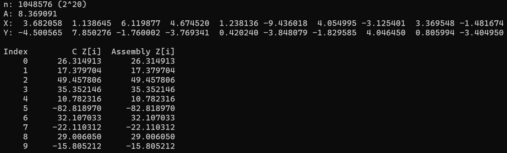
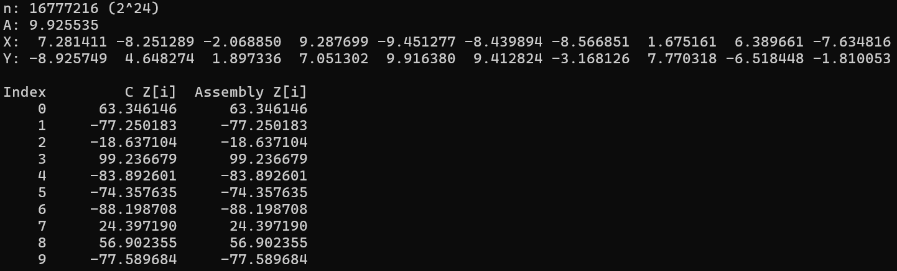
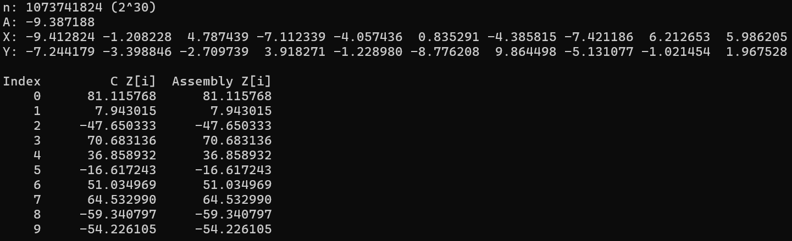
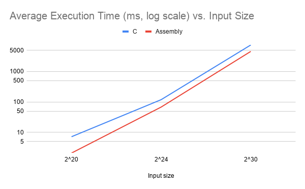

# SAXPY (A*X + Y) Kernel: C vs. Assembly Comparison

## Group 7 LBYARCH S30G
- Almero, Antonio Alvaro
- Marquez, John Thomas

## Build & Run Instructions

Ensure `nasm.exe` and `gcc.exe` are added to your system's or user's PATH before proceeding.

### Via Visual Studio
1. Open `MP2.sln`
2. Build solution (`Ctrl + Shift + B`)
3. Open terminal (`` Ctrl + ` ``)
4. Run `.\main.exe <exponent>`

`<exponent>` is required and must be one of `20`, `24`, `28`, or `30`.
The program uses vectors of size n = 2<sup>exponent</sup>.

In addition to 30 as an option for a large exponent of n, 28 is provided for machines that may not be able to process a vector size of 2<sup>30</sup>.

### Via File Explorer
1. Open terminal at project root
2. Compile source code 
```
nasm -f win64 saxpyASM.asm -o saxpyASM.obj
gcc main.c saxpyASM.obj -o main.exe
```
Alternatively, you can run `build.bat` to compile the program.

3. Run executable file
```
main.exe <exponent>
```

## Test Device Specifications
AMD Ryzen 5 4600H  
32 GB RAM

## n = 2<sup>20</sup>

### Parameter Values and First 10 Rows of Z (n = 2<sup>20</sup>)


### Execution Time Comparison (n = 2<sup>20</sup>)
| Run | C (ms) | Assembly (ms) |
|---:|---:|---:|
| 1 | 6.615400 | 0.919200 |
| 2 | 7.157900 | 0.912800 |
| 3 | 6.628800 | 4.150600 |
| 4 | 7.223800 | 0.926700 |
| 5 | 6.627100 | 0.917500 |
| 6 | 6.962600 | 4.070400 |
| 7 | 6.970200 | 4.293200 |
| 8 | 8.748300 | 0.917500 |
| 9 | 9.182100 | 1.314000 |
| 10 | 9.474300 | 0.933900 |
| 11 | 8.806700 | 2.201200 |
| 12 | 9.421000 | 2.942400 |
| 13 | 8.992500 | 0.918900 |
| 14 | 7.064400 | 2.453800 |
| 15 | 6.620400 | 0.925500 |
| 16 | 6.644700 | 0.920100 |
| 17 | 6.626100 | 4.105900 |
| 18 | 6.662700 | 0.916000 |
| 19 | 6.617300 | 0.916200 |
| 20 | 6.744900 | 3.791400 |
| 21 | 6.632800 | 2.999900 |
| 22 | 6.626600 | 0.916700 |
| 23 | 7.419900 | 2.630900 |
| 24 | 6.627700 | 3.360300 |
| 25 | 6.734400 | 2.518300 |
| 26 | 6.629200 | 0.916800 |
| 27 | 6.695300 | 2.816900 |
| 28 | 6.630600 | 3.855700 |
| 29 | 6.628600 | 0.933700 |
| 30 | 6.689200 | 2.706200 |
| **Average** | **7.236850** | **2.103420** |

Over 30 runs at n = 2<sup>20</sup>, the Assembly version was, on average, **3.44×** faster than the C version.

## n = 2<sup>24</sup>

### Parameter Values and First 10 Rows of Z (n = 2<sup>24</sup>)


### Execution Time Comparison (n = 2<sup>24</sup>)
| Run | C (ms) | Assembly (ms) |
|---:|---:|---:|
| 1 | 141.851300 | 69.810300 |
| 2 | 119.518700 | 68.817400 |
| 3 | 111.065300 | 70.179000 |
| 4 | 113.389600 | 68.392000 |
| 5 | 111.924900 | 69.299500 |
| 6 | 149.255200 | 69.224900 |
| 7 | 108.186800 | 63.558800 |
| 8 | 111.623000 | 70.712000 |
| 9 | 124.394900 | 67.200900 |
| 10 | 108.932100 | 68.413300 |
| 11 | 110.827800 | 69.700600 |
| 12 | 116.267500 | 68.558800 |
| 13 | 106.564900 | 68.309800 |
| 14 | 118.814300 | 66.853000 |
| 15 | 109.094400 | 68.602300 |
| 16 | 108.934200 | 68.853900 |
| 17 | 136.541800 | 68.361200 |
| 18 | 115.619500 | 63.772700 |
| 19 | 128.112800 | 64.480600 |
| 20 | 124.631100 | 66.293000 |
| 21 | 106.875200 | 71.954300 |
| 22 | 132.239900 | 71.259400 |
| 23 | 118.089600 | 65.324800 |
| 24 | 107.522900 | 67.448000 |
| 25 | 120.707200 | 66.557800 |
| 26 | 117.191300 | 68.316800 |
| 27 | 132.577100 | 68.425700 |
| 28 | 116.184200 | 69.209200 |
| 29 | 114.027400 | 70.012600 |
| 30 | 136.575700 | 67.771700 |
| **Average** | **119.251353** | **68.189143** |

Over 30 runs at n = 2<sup>24</sup>, the Assembly version was, on average, **1.75×** faster than the C version.

## n = 2<sup>30</sup>

### Parameter Values and First 10 Rows of Z (n = 2<sup>30</sup>)


### Execution Time Comparison (n = 2<sup>30</sup>)
| Run | C (ms) | Assembly (ms) |
|---:|---:|---:|
| 1 | 8274.161000 | 4581.151300 |
| 2 | 5188.647200 | 4595.756700 |
| 3 | 4737.659300 | 4610.167200 |
| 4 | 7855.506800 | 4668.252500 |
| 5 | 8655.091700 | 4567.697000 |
| 6 | 8060.579500 | 4600.741700 |
| 7 | 6896.906800 | 4612.443400 |
| 8 | 3954.558900 | 4572.608200 |
| 9 | 8463.069100 | 4553.679500 |
| 10 | 8365.545300 | 4605.490400 |
| 11 | 8314.229900 | 4556.253200 |
| 12 | 8551.191600 | 4564.346300 |
| 13 | 8088.848300 | 4578.173700 |
| 14 | 7635.027300 | 4566.280600 |
| 15 | 7721.413900 | 4582.288000 |
| 16 | 7567.856200 | 4574.670000 |
| 17 | 7448.248400 | 4579.637700 |
| 18 | 7662.642700 | 4558.302700 |
| 19 | 7594.450900 | 4585.509800 |
| 20 | 7607.282500 | 4601.340900 |
| 21 | 7519.968900 | 4609.622500 |
| 22 | 7471.411900 | 4549.846500 |
| 23 | 7558.138100 | 4583.806400 |
| 24 | 7583.616200 | 4577.639800 |
| 25 | 7581.511600 | 4578.191200 |
| 26 | 7502.325700 | 4597.959700 |
| 27 | 7662.368200 | 4624.708100 |
| 28 | 7450.724400 | 4625.610700 |
| 29 | 7487.635800 | 4563.775400 |
| 30 | 7557.198900 | 4615.824500 |
| **Average** | **7467.260567** | **4588.059187** |

Over 30 runs at n = 2<sup>30</sup>, the Assembly version was, on average, **1.63×** faster than the C version.

## Summary of Findings

On average, the Assembly implementation achieved a geometric mean speedup of **2.14×** over the C program across the three tested input sizes. Its relative speedup fell from **3.44×** at 2<sup>20</sup> elements to **1.63×** at 2<sup>30</sup> elements.



As shown in the line chart, the Assembly kernel's performance advantage over the C kernel **shrank as the input size increased**.